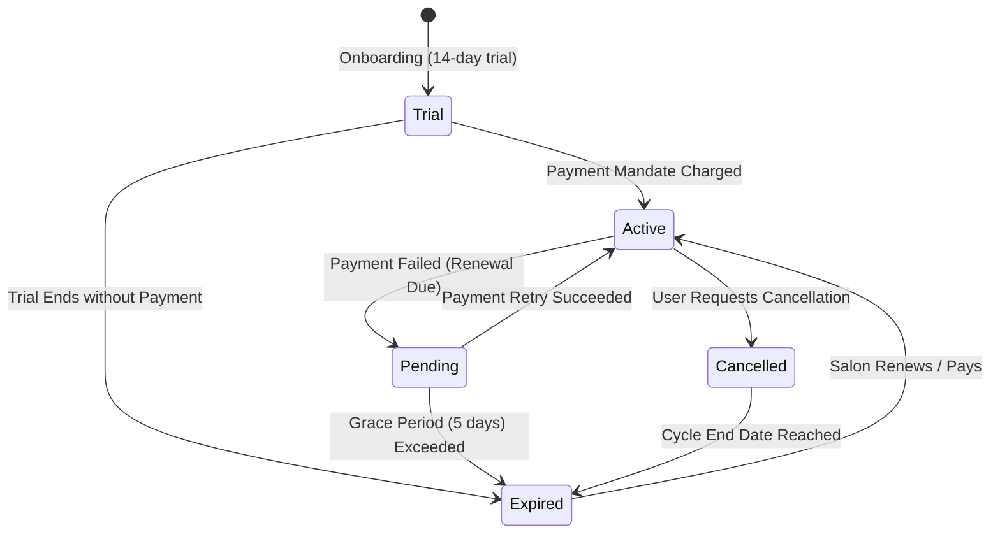
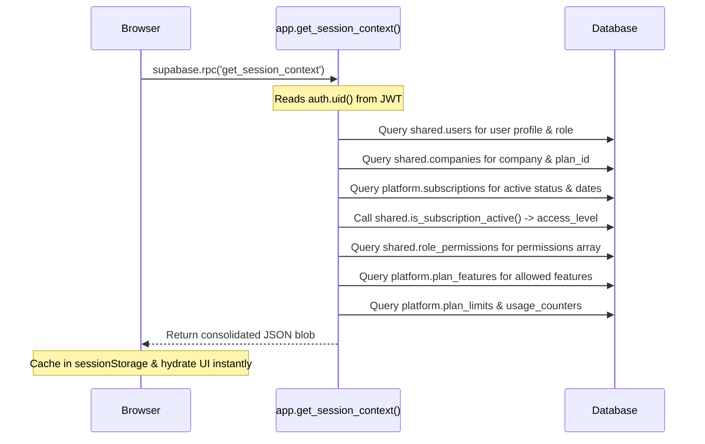
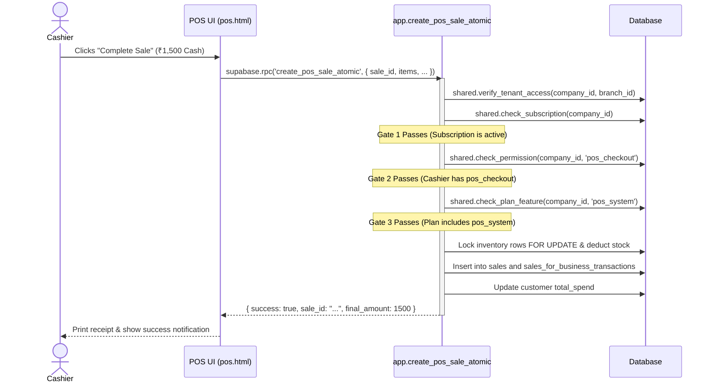

# BharathBots Salon SaaS — Complete Authorization & Access Control Guide

> **Document Type**: Comprehensive Architectural & Developer Guide  
> **Target Audience**: Backend Developers, Frontend Engineers, Security Auditors  
> **Scope**: 3-Gate Authorization Model, Subscription Validity Engine, RBAC, Commercial Plan Tiering, Quota Ceilings, and Zero-Trust Backend Enforcement.

---

## Table of Contents

1. [Architecture Overview & Zero-Trust Core Principles](#1-architecture-overview--zero-trust-core-principles)
2. [The 3-Gate + Quota Model](#2-the-3-gate--quota-model)
3. [Gate 1: Subscription Lifecycle & Validity Engine](#3-gate-1-subscription-lifecycle--validity-engine)
   - [Subscription Status Lifecycle](#subscription-status-lifecycle)
   - [Exact Date & Status Math (`is_subscription_active`)](#exact-date--status-math-is_subscription_active)
   - [Full Access vs. Read-Only Mode](#full-access-vs-read-only-mode)
   - [Exempt Procedures (Always Permitted Even When Expired)](#exempt-procedures-always-permitted-even-when-expired)
4. [Gate 2: In-App RBAC (Role-Based Access Control)](#4-gate-2-in-app-rbac-role-based-access-control)
   - [User Identity Resolution](#user-identity-resolution)
   - [Storage Pattern (`shared.role_permissions`)](#storage-pattern-sharedrole_permissions)
   - [Owner & Super Admin Wildcard Bypass (`ALL`)](#owner--super-admin-wildcard-bypass-all)
   - [Permission Hierarchy & Granular Sub-Features](#permission-hierarchy--granular-sub-features)
5. [Gate 3: Commercial Plan Tier Entitlements](#5-gate-3-commercial-plan-tier-entitlements)
   - [Plan Hierarchy (Growth, Advance, Pro, Enterprise)](#plan-hierarchy-growth-advance-pro-enterprise)
   - [Plan Feature Registry & Storage](#plan-feature-registry--storage)
   - [Upgrade Prompts & UI Interceptors](#upgrade-prompts--ui-interceptors)
6. [Quota Gate: Dynamic Capacity Limits & Usage Counters](#6-quota-gate-dynamic-capacity-limits--usage-counters)
   - [Capacity Metrics (`max_branches`, `max_users`, `max_staff`)](#capacity-metrics-max_branches-max_users-max_staff)
   - [Enforcement Flow in Atomic RPCs](#enforcement-flow-in-atomic-rpcs)
7. [The Session Context Pipeline (`get_session_context`)](#7-the-session-context-pipeline-get_session_context)
   - [Cold Start vs. Hot Cache Navigation (< 2ms)](#cold-start-vs-hot-cache-navigation--2ms)
   - [30-Minute Silent Background Heartbeat](#30-minute-silent-background-heartbeat)
8. [End-to-End Tracing: What Happens When a Button is Clicked?](#8-end-to-end-tracing-what-happens-when-a-button-is-clicked)
   - [Scenario A: Checking out a POS Sale](#scenario-a-checking-out-a-pos-sale)
   - [Scenario B: Booking an Appointment](#scenario-b-booking-an-appointment)
   - [Scenario C: Attempting an Action with an Expired Subscription](#scenario-c-attempting-an-action-with-an-expired-subscription)
   - [Scenario D: Malicious PostgREST API Call (Bypassing Frontend)](#scenario-d-malicious-postgrest-api-call-bypassing-frontend)
9. [Developer Reference Table (Gates Applied per Stored Procedure)](#9-developer-reference-table-gates-applied-per-stored-procedure)

---

## 1. Architecture Overview & Zero-Trust Core Principles

The authorization architecture operates across two distinct tiers:

```mermaid
flowchart TD
    subgraph Browser ["Client Browser Tier (UX Guidance Only)"]
        UI["User Interface (Buttons, Modals, Forms)"]
        Guard["global-auth-guard.js"]
        Managers["Managers (Subscription, RBAC, Plan Features, Plan Limits)"]
        Cache[("sessionStorage / localStorage Caches")]
    end

    subgraph Backend ["Authoritative Backend Tier (Zero-Trust Enforcement)"]
        AuthUID["auth.uid() (Cryptographic JWT Token)"]
        RPC["Atomic Stored Procedures (SECURITY DEFINER)"]
        Gate1["Gate 1: shared.check_subscription()"]
        Gate2["Gate 2: shared.check_permission()"]
        Gate3["Gate 3: shared.check_plan_feature()"]
        Quota["Quota: shared.check_quota()"]
        Tables[("PostgreSQL Tables (app, platform, shared)")]
    end

    UI -->|Click Button / Load Route| Guard
    Guard <--> Cache
    Guard --> Managers
    UI -->|Call supabase.rpc()| RPC
    RPC --> AuthUID
    RPC --> Gate1
    RPC --> Gate2
    RPC --> Gate3
    RPC --> Quota
    Quota --> Tables
    Gate1 --> Tables
    Gate2 --> Tables
    Gate3 --> Tables
```

### The Golden Rule: Frontend is UX, Backend is Authority
- **The Browser is inherently untrusted**: A user can edit `localStorage`, inject JavaScript via the console, or directly call the Supabase PostgREST API using `curl` or `fetch()`.
- **Frontend Gates**: Provide immediate user feedback, hide inaccessible navigation links, disable buttons, and trigger upgrade/renewal modals.
- **Backend Gates**: Embedded inside every mutation procedure (`*_atomic`). Even if a user bypasses all frontend code, PostgreSQL rejects the request with typed SQL exceptions (`SUBSCRIPTION_EXPIRED`, `PERMISSION_DENIED`, `PLAN_FEATURE_LOCKED`, `PLAN_LIMIT_REACHED`).

---

## 2. The 3-Gate + Quota Model

Every protected operation in the system must clear up to **four validation checkpoints**:

| Gate | Name | Governed By | Question Answered | Failure Exception |
|:---:|---|---|---|---|
| **Gate 1** | **Subscription Lifecycle** | `shared.check_subscription()` | Is the salon's account active, in trial, or within grace period? | `SUBSCRIPTION_EXPIRED` |
| **Gate 2** | **In-App RBAC** | `shared.check_permission()` | Does this logged-in user's role have permission to execute this specific action? | `PERMISSION_DENIED` |
| **Gate 3** | **Plan Tier Entitlement** | `shared.check_plan_feature()` | Did the salon purchase the commercial plan tier (Growth, Advance, Pro) that includes this module? | `PLAN_FEATURE_LOCKED` |
| **Quota** | **Capacity Limit** | `shared.check_quota()` | Has the company exceeded its allocated branches, staff, or user accounts? | `PLAN_LIMIT_REACHED` |

---

## 3. Gate 1: Subscription Lifecycle & Validity Engine

### Subscription Status Lifecycle

A salon tenant's lifecycle is tracked in `platform.subscriptions` using the following statuses:



| Status | Meaning | Access Level Granted |
|---|---|:---:|
| `active` | Paid subscription in good standing | **Full Access** (Read + Write) |
| `trial` | Free introductory trial period | **Full Access** (Read + Write until `trial_end_at`) |
| `authenticated` | Payment mandate setup and authorized; awaiting first cycle | **Full Access** (Read + Write) |
| `pending` | Renewal payment attempted and pending/retrying | **Full Access** if within `grace_period_end_at`; otherwise **Read-Only** |
| `cancelled` (Paid) | Cancellation requested, but current billing cycle is still active | **Full Access** until `current_period_end_at`; then **Read-Only** |
| `cancelled` (Trial) | Trial cancellation | **Immediate Read-Only** (no grace period) |
| `paused` / `halted` | Administrative pause or dispute hold | **Read-Only** |
| `completed` / `expired` | Period expired without renewal | **Read-Only** |

---

### Exact Date & Status Math (`is_subscription_active`)

The server-side function `shared.is_subscription_active(...)` in PostgreSQL mirrors the frontend date logic in `config/subscription-state-manager.js`:

```sql
CREATE OR REPLACE FUNCTION shared.is_subscription_active(
    p_status                 text,
    p_is_trial               boolean,
    p_current_period_end_at  timestamptz,
    p_trial_end_at           timestamptz,
    p_grace_period_end_at    timestamptz
) RETURNS boolean ...
```

#### Evaluation Rules:
1. **Effective End Date Resolution**:
   - If Trial: Uses `COALESCE(trial_end_at, current_period_end_at)`
   - If Paid: Uses `COALESCE(current_period_end_at, trial_end_at)`
2. **Time Check**: `v_time_valid := (effective_end IS NULL OR effective_end > NOW())`
3. **Grace Period Check**: `v_in_grace := (grace_period_end_at IS NOT NULL AND grace_period_end_at > NOW())`
4. **Outcome**:
   - `status = 'active'`: Returns `true` if `v_time_valid`
   - `status = 'trial'`: Returns `true` if `v_time_valid`
   - `status = 'cancelled' AND is_trial = true`: Returns `false` immediately
   - `status = 'cancelled' AND is_trial = false`: Returns `true` until `current_period_end_at`
   - `status = 'pending'`: Returns `true` if `v_in_grace OR v_time_valid`
   - `status IN ('paused', 'halted', 'completed')`: Returns `false`

---

### Full Access vs. Read-Only Mode

When a salon's subscription expires, **they are NEVER locked out of their historical data**:
- **Allowed in Read-Only Mode**:
  - View all 22 dashboard pages, past appointments, customer profiles, past sales receipts, invoices, and reports.
  - Export past accounting data and transaction logs.
  - Contact customer support and chat with helpdesk.
  - Access billing & subscription settings to renew or change plan.
- **Blocked in Read-Only Mode**:
  - Creating new bookings or walk-ins.
  - Processing POS sales or issuing cash/card refunds.
  - Adding new staff members, services, or products.
  - Modifying company settings or branch details.

---

### Exempt Procedures (Always Permitted Even When Expired)

To ensure an expired salon can renew its account and contact support, the following atomic procedures **do not call `shared.check_subscription()`**:
- `submit_issue_atomic`, `add_issue_message_atomic` (Customer Support tickets)
- `save_billing_information_atomic`, `cancel_subscription_addon_atomic`, `reactivate_subscription_addon_atomic` (Billing Management)
- `mark_notification_read_atomic`, `mark_all_notifications_read` (System alerts)
- `update_user_last_login_atomic`, `update_user_profile_name_phone_atomic`, `upsert_user_preferences_atomic` (User profile self-service)

---

## 4. Gate 2: In-App RBAC (Role-Based Access Control)

### User Identity Resolution
The backend **never trusts a `user_id` passed in the request body**. It reads `auth.uid()` directly from the validated Supabase JWT header:

```sql
v_uid := auth.uid();
SELECT * INTO v_user
FROM shared.users
WHERE user_id = v_uid AND company_id = p_company_id AND status = 'active';
```

If the user does not exist in `shared.users` or does not belong to the target `company_id`, the request fails immediately.

---

### Storage Pattern (`shared.role_permissions`)

Permissions are stored in `shared.role_permissions` using an authoritative single-row JSON array in the `permission_key` column:

```
role_id: "c4b3a123-..."
company_id: "f82b7194-..."
permission_key: "[\"dashboard_access\", \"create_booking\", \"pos_checkout\", \"customer_create\"]"
status: "active"
```

---

### Owner & Super Admin Wildcard Bypass (`ALL`)

Inside `shared.check_permission(p_company_id, p_required_key)`:
1. If caller's `auth.role()` is `service_role` (Edge Functions / Cron) $\rightarrow$ **Bypasses check**.
2. If `v_user.role_name` is `owner` or `super_admin` $\rightarrow$ **Bypasses check** (Owners possess universal authority).
3. If `permission_key` JSON array contains `"ALL"` $\rightarrow$ **Bypasses check**.
4. Otherwise, checks if `v_perm_arr ? p_required_key` $\rightarrow$ If not found, raises `PERMISSION_DENIED: Missing permission: <key>`.

---

## 5. Gate 3: Commercial Plan Tier Entitlements

### Plan Hierarchy
The application provides tiered commercial packaging:
1. **Growth Plan**: Core bookings, single branch, basic POS, standard reports.
2. **Advance Plan**: Multi-branch (up to 3), marketing suite (coupons, offers, memberships), advanced analytics, expenses.
3. **Pro Plan**: Full multi-branch (up to 10), automated notifications, full marketing & reporting.
4. **Enterprise Plan**: Custom branches, dedicated support, custom integrations.

---

### Plan Feature Registry & Storage
Allowed features per plan are stored in `platform.plan_features` as a single-row JSON string array:

```sql
SELECT feature_key INTO v_feature_text
FROM platform.plan_features
WHERE plan_id = v_company.plan_id;
-- e.g. ["dashboard_access", "pos_system", "bookings_management", "marketing_memberships"]
```

When an RPC executes (e.g. `assign_membership_atomic`), it calls:
```sql
PERFORM shared.check_plan_feature(p_company_id, 'marketing_memberships');
```
If the salon's current plan does not include `'marketing_memberships'`, PostgreSQL raises `PLAN_FEATURE_LOCKED`.

---

## 6. Quota Gate: Dynamic Capacity Limits & Usage Counters

### Capacity Metrics
Commercial tiers limit scale by counting active resources:
- `max_branches`: Number of active physical salon branches.
- `max_users`: Number of staff login accounts in `shared.users`.
- `max_staff`: Number of stylists and team members in `app.staff`.

Ceilings are stored in `platform.plan_limits`:
```
plan_id: <Growth_UUID>, limit_key: 'max_branches', limit_value: 1
plan_id: <Advance_UUID>, limit_key: 'max_branches', limit_value: 3
plan_id: <Pro_UUID>, limit_key: 'max_branches', limit_value: 10
```

Live consumption is tracked in `platform.usage_counters` (`metric_key`, `current_count`).

---

### Enforcement Flow in Atomic RPCs

Before executing an `INSERT` in `create_branch_atomic`, `create_user_atomic`, or `create_staff_atomic`:

```sql
PERFORM shared.check_quota(p_company_id, 'max_branches');
```

Inside `shared.check_quota()`:
1. Reads `limit_value` from `platform.plan_limits` for the company's `plan_id`.
2. Reads `current_count` from `platform.usage_counters`.
3. If `current_count >= limit_value`, PostgreSQL raises:
   `PLAN_LIMIT_REACHED: max_branches limit reached (3 / 3). Upgrade your plan to add more.`

---

## 7. The Session Context Pipeline (`get_session_context`)

To eliminate multiple round-trips on page load and avoid client-side state manipulation, a single atomic RPC is executed:



### Response Payload Structure
```json
{
  "user": {
    "user_id": "a3b2...",
    "name": "Priya Sharma",
    "email": "priya@example.com",
    "role_name": "Manager",
    "role_id": "r1...",
    "branch_id": "b1...",
    "status": "active"
  },
  "company": {
    "company_id": "c1...",
    "company_name": "Glow Salon & Spa",
    "plan_id": "p1...",
    "plan_name": "Advance",
    "status": "active"
  },
  "subscription": {
    "access_level": "full",
    "status": "active",
    "is_trial": false,
    "current_period_end_at": "2026-12-01T00:00:00Z",
    "days_remaining": 27,
    "is_expiring_soon": false,
    "plan_name": "Advance Plan",
    "billing_cycle": "monthly",
    "auto_renew": true
  },
  "permissions": ["dashboard_access", "create_booking", "pos_checkout", "customer_create"],
  "plan_features": ["dashboard_access", "bookings_management", "pos_system", "marketing_coupons"],
  "plan_limits": { "max_branches": 3, "max_users": 5, "max_staff": 20 },
  "usage": { "max_branches": 2, "max_users": 3, "max_staff": 12 }
}
```

---

## 8. End-to-End Tracing: What Happens When a Button is Clicked?

### Scenario A: Checking out a POS Sale



---

### Scenario B: Booking an Appointment
1. **Frontend check**: `global-booking-modal.js` checks `subscriptionState.accessLevel === 'full'`.
2. **Invocation**: Calls `supabase.rpc('create_booking_atomic', payload)`.
3. **Backend Gates**:
   - `shared.verify_tenant_access`: Verifies caller belongs to company and branch.
   - `shared.check_subscription`: Confirms subscription is active.
   - `shared.check_permission`: Checks for `'create_booking'`.
   - `shared.check_plan_feature`: Checks for `'bookings_management'`.
4. **Business logic**: Deduplicates customer by phone, validates branch operating hours, checks staff shifts, and detects collision/overlap before inserting.

---

### Scenario C: Attempting an Action with an Expired Subscription
1. **Frontend UX**:
   - `global-auth-guard.js` detects `accessLevel === 'read-only'`.
   - Injects red notification banner across the top: *"Your subscription has expired. Read-Only mode active. Click here to renew."*
   - Forms and mutation buttons are disabled or hidden.
2. **If User Bypasses UI (Re-enables button in DevTools)**:
   - User clicks "Add Service" $\rightarrow$ sends RPC call to `create_service_atomic`.
   - In PostgreSQL: `shared.check_subscription(p_company_id)` runs.
   - Status is `expired` and period end date has passed.
   - **PostgreSQL raises exception**: `SUBSCRIPTION_EXPIRED: Subscription is not active. Status: expired`.
   - Transaction aborts and rolls back completely. Zero data is modified.

---

### Scenario D: Malicious PostgREST API Call (Bypassing Frontend)
Suppose an attacker acquires an authenticated token for a receptionist user and uses `curl` to call:
```bash
POST /rest/v1/rpc/create_branch_atomic
{ "p_company_id": "...", "p_branch_name": "Unauthorized Branch" }
```
1. `shared.verify_tenant_access` resolves `auth.uid()` from the token.
2. `shared.check_subscription` verifies subscription.
3. `shared.check_permission(p_company_id, 'branch_create')` executes:
   - Receptionist role does **not** possess `'branch_create'`.
   - Caller is not owner or super_admin.
   - **PostgreSQL raises**: `PERMISSION_DENIED: Missing permission: branch_create`.
   - The HTTP response returns `400 Bad Request` with error message `PERMISSION_DENIED`. The unauthorized branch is never created.

---

## 9. Developer Reference Table (Gates Applied per Stored Procedure)

| Module | Procedure Name | Gate 1 (Sub) | Gate 2 (RBAC Permission) | Gate 3 (Plan Feature) | Quota Check |
|---|---|:---:|:---:|:---:|:---:|
| **POS** | `create_pos_sale_atomic` | ✅ | `pos_checkout` | `pos_system` | — |
| **POS** | `process_pos_refund_atomic` | ✅ | `pos_issue_refund` | — | — |
| **Bookings** | `create_booking_atomic` | ✅ | `create_booking` | `bookings_management` | — |
| **Bookings** | `update_booking_atomic` | ✅ | `update_booking` | — | — |
| **Bookings** | `cancel_booking_atomic` | ✅ | `cancel_booking` | — | — |
| **Bookings** | `process_booking_payment_atomic` | ✅ | `collect_payment` | — | — |
| **Bookings** | `process_booking_refund_atomic` | ✅ | `booking_refund` | — | — |
| **Memberships**| `assign_membership_atomic` | ✅ | `assign_membership` | `marketing_memberships` | — |
| **Memberships**| `process_membership_refund_atomic` | ✅ | `refund_membership` | — | — |
| **Memberships**| `create_membership_plan` | ✅ | `create_membership` | `marketing_memberships` | — |
| **Branches** | `create_branch_atomic` | ✅ | `branch_create` | — | `max_branches` |
| **IAM Users** | `create_user_atomic` | ✅ | `user_create` | — | `max_users` |
| **Staff** | `create_staff_atomic` | ✅ | `create_staff` | — | `max_staff` |
| **Staff** | `update_staff_atomic` | ✅ | `update_staff` | — | — |
| **Staff** | `save_staff_schedule_atomic` | ✅ | `create_staff_schedule` | — | — |
| **Services** | `create_service_atomic` | ✅ | `create_service` | `services_management` | — |
| **Services** | `update_service_atomic` | ✅ | `update_service` | — | — |
| **Services** | `delete_service_atomic` | ✅ | `delete_service` | — | — |
| **Products** | `create_product_atomic` | ✅ | `create_product` | `product_management` | — |
| **Products** | `update_product_atomic` | ✅ | `update_product` | — | — |
| **Expenses** | `create_expense_atomic` | ✅ | `expenses_create` | `analytics_expenses` | — |
| **Marketing** | `create_coupon_atomic` | ✅ | `create_coupon` | `marketing_coupons` | — |
| **Marketing** | `create_offer_atomic` | ✅ | `create_offer` | `marketing_offers` | — |
| **Settings** | `save_business_hours_atomic` | ✅ | `settings_edit` | — | — |
| **Settings** | `save_role_permissions_atomic`| ✅ | `role_edit` | — | — |
| **Settings** | `save_company_tax_settings_atomic`| ✅ | `settings_edit` | — | — |
| **Settings** | `save_invoice_settings_atomic`| ✅ | `settings_edit` | — | — |
| **Settings** | `save_notification_settings_atomic`| ✅ | `settings_edit` | — | — |
| **Support** | `submit_issue_atomic` | ❌ *(Exempt)* | — | — | — |
| **Support** | `add_issue_message_atomic` | ❌ *(Exempt)* | — | — | — |
| **Billing** | `save_billing_information_atomic` | ❌ *(Exempt)* | — | — | — |
| **Billing** | `cancel_subscription_addon_atomic`| ❌ *(Exempt)* | — | — | — |
| **Alerts** | `mark_notification_read_atomic` | ❌ *(Exempt)* | — | — | — |

