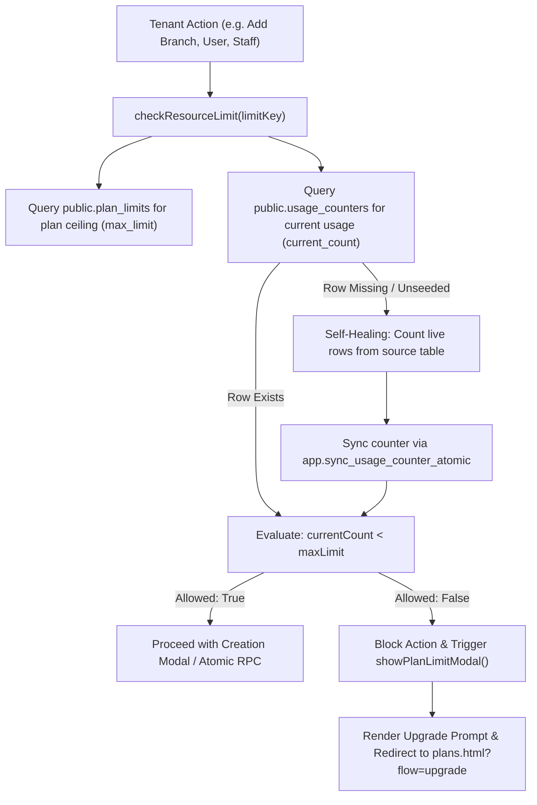

# Module 14: SaaS Billing & Subscriptions — Developer Interaction & Technical Map

## 1. Module Overview & Principles

The **SaaS Billing & Subscriptions** module governs the commercial lifecycle of tenant accounts within BharathBots Salon SaaS. It encompasses plan catalog exploration, subscription tier upgrades/downgrades, billing frequency selection (monthly vs. annual), dynamic quota/resource ceiling enforcement, commercial feature gating, modular add-on checkout and deactivation, business tax/legal invoice profiles, and payment ledger inspection with tax invoice generation.

### Core Architectural Principles
1. **Zero-Trust Authoritative Subscriptions**:
   - The frontend never directly modifies subscription records, plan assignments, add-on states, or quota counters.
   - All state transitions (e.g., add-on cancellation, reactivation, quota synchronization, billing profile persistence) are executed through authoritative `SECURITY DEFINER` routines in PostgreSQL (`app` schema with `public` bridges) and secured Supabase Edge Functions.
2. **Tenant Context Enforced**:
   - Every procedure executes `shared.verify_tenant_access(p_company_id, NULL)` to guarantee absolute isolation between tenant billing records.
3. **Razorpay SDK & Webhook Decoupling**:
   - Subscription orders, payment mandates for trials, and modular add-on checkouts are initiated server-side via Supabase Edge Functions (`create-razorpay-subscription`, `purchase-addon`, `cancel-subscription`).
   - Cryptographic signatures (`razorpay_signature`, `razorpay_payment_id`, `razorpay_order_id`) are verified server-side prior to mutating tenant subscription state.
4. **Self-Healing Quota Counters**:
   - Ceilings (`plan_limits`) and actual usage counts (`usage_counters`) are maintained through database rows and synchronized automatically via `sync_usage_counter_atomic`.

---

## 2. File & Script Architecture

### Pages (Views)
- [`billing-subscription.html`](file:///c:/Users/viswa/OneDrive/Desktop/salon-saas-frontend/billing-subscription.html): Main Hub displaying current plan status, active add-ons, plan features matrix, payment method display, next billing summary, payment history ledger, legal billing info, and subscription cancellation.
- [`manage-addons.html`](file:///c:/Users/viswa/OneDrive/Desktop/salon-saas-frontend/manage-addons.html): Dedicated 3-column management console (Available Add-ons, Scheduled Changes, Billing Summary & Action).
- [`plans.html`](file:///c:/Users/viswa/OneDrive/Desktop/salon-saas-frontend/plans.html): Plan catalog & tier comparison grid (Growth, Advance, Pro) supporting both onboarding and existing-tenant upgrade flows.
- [`payments.html`](file:///c:/Users/viswa/OneDrive/Desktop/salon-saas-frontend/payments.html): 2-column checkout page for subscription purchases, annual discount toggling, and 7-day free trial authorization mandate setups.
- [`payment-result.html`](file:///c:/Users/viswa/OneDrive/Desktop/salon-saas-frontend/payment-result.html): Post-checkout verification and onboarding handoff page.

### JavaScript Modules
- [`billing-subscription.js`](file:///c:/Users/viswa/OneDrive/Desktop/salon-saas-frontend/billing-subscription.js): Thin orchestrator loading modular components dynamically via native ES modules.
- [`scripts/billing/billing-state.js`](file:///c:/Users/viswa/OneDrive/Desktop/salon-saas-frontend/scripts/billing/billing-state.js): Reactive state container holding plan metadata, active add-ons, catalog items, tax rates, payment history, and billing info.
- [`scripts/billing/billing-api.js`](file:///c:/Users/viswa/OneDrive/Desktop/salon-saas-frontend/scripts/billing/billing-api.js): Authoritative data loader reading subscriptions, add-ons, payments ledger, tax settings, and subscribing to Postgres realtime changes on `subscriptions`.
- [`scripts/billing/billing-renders.js`](file:///c:/Users/viswa/OneDrive/Desktop/salon-saas-frontend/scripts/billing/billing-renders.js): Pure DOM rendering engine for all plan cards, feature lists, summary tables, and modals.
- [`scripts/billing/billing-modal-addons.js`](file:///c:/Users/viswa/OneDrive/Desktop/salon-saas-frontend/scripts/billing/billing-modal-addons.js): Add-on duration selector, Razorpay checkout launcher, and inline add-on deactivation/reactivation handlers.
- [`scripts/billing/billing-modal-cancel.js`](file:///c:/Users/viswa/OneDrive/Desktop/salon-saas-frontend/scripts/billing/billing-modal-cancel.js): Cancellation feedback survey modal with conditional feedback capture and Edge Function dispatcher.
- [`scripts/billing/billing-modal-billing.js`](file:///c:/Users/viswa/OneDrive/Desktop/salon-saas-frontend/scripts/billing/billing-modal-billing.js): Legal business name, GSTIN, PAN, and structured address editor dispatching `save_billing_information`.
- [`scripts/billing/billing-modal-payment.js`](file:///c:/Users/viswa/OneDrive/Desktop/salon-saas-frontend/scripts/billing/billing-modal-payment.js): Read-only payment method visualizer (RBI compliance & e-NACH mandate indicators).
- [`scripts/billing/billing-modal-invoice.js`](file:///c:/Users/viswa/OneDrive/Desktop/salon-saas-frontend/scripts/billing/billing-modal-invoice.js): Itemized tax invoice preview modal and CSV transaction history exporter.
- [`scripts/billing/manage-addons-page.js`](file:///c:/Users/viswa/OneDrive/Desktop/salon-saas-frontend/scripts/billing/manage-addons-page.js): Dedicated 3-column page controller managing live multi-select deltas, net price diff calculations, and database mutations.
- [`scripts/plans.js`](file:///c:/Users/viswa/OneDrive/Desktop/salon-saas-frontend/scripts/plans.js): Tier hierarchy manager, billing cycle toggle (monthly/annual), and upgrade routing.
- [`payments.js`](file:///c:/Users/viswa/OneDrive/Desktop/salon-saas-frontend/payments.js): Razorpay checkout integration for paid plans and authorization mandates for trials.
- [`config/plan-limits-manager.js`](file:///c:/Users/viswa/OneDrive/Desktop/salon-saas-frontend/config/plan-limits-manager.js): Dynamic resource quota checker (`max_branches`, `max_users`, `max_staff`) with self-healing counter synchronization.
- [`config/plan-features-manager.js`](file:///c:/Users/viswa/OneDrive/Desktop/salon-saas-frontend/config/plan-features-manager.js): Commercial tier feature flag evaluator interfacing `platform.plan_features`.

---

## 3. Database Procedures & Edge Functions

### 3.1 PostgreSQL Stored Procedures (`app` & `public`)

| Stored Procedure | Schemas | Parameters | Description & Invariants Enforced |
|---|---|---|---|
| `cancel_subscription_addon_atomic` | `app`, `public` | `p_company_id uuid, p_addon_id uuid` | Verifies tenant access. Updates `platform.subscription_add_ons` to `status = 'cancelling'` and `updated_at = NOW()`. Enforces that the add-on must currently be in `'active'` status. Does not revoke access immediately; access remains valid until `ended_at`. |
| `reactivate_subscription_addon_atomic` | `app`, `public` | `p_company_id uuid, p_addon_id uuid` | Verifies tenant access. Reverts `status = 'active'` for an add-on currently marked as `'cancelling'` where the paid billing period has not yet elapsed. Restores auto-renewal. |
| `sync_plan_features_atomic` | `app`, `public` | `p_plan_id uuid, p_feature_keys jsonb` | Synchronizes the master feature array for a given plan tier in `platform.plan_features`. Stores all feature keys as a single JSON array text row, deduplicating extra rows if found. |
| `sync_usage_counter_atomic` | `app`, `public` | `p_company_id uuid, p_limit_key text, p_current_count int DEFAULT NULL, p_max_limit int DEFAULT NULL, p_plan_id uuid DEFAULT NULL, p_branch_id uuid DEFAULT NULL` | Verifies tenant access. Authoritative upsert of live quota counters in `platform.usage_counters`. Preserves existing values with `COALESCE` if parameters are omitted. |
| `backfill_oauth_phone_atomic` | `app`, `public` | `p_company_id uuid, p_user_id uuid, p_phone text` | Verifies tenant access. Authoritative update of customer phone numbers into `shared.users` and `shared.profiles` following checkout. |
| `save_billing_information` | `app`, `public` | `p_company_id uuid, p_data jsonb` | Verifies tenant access. Authoritative upsert of tenant legal name, GSTIN, PAN, billing email, phone, and structured street address into `platform.company_billing_information`. |

### 3.2 Supabase Edge Functions

| Edge Function | Endpoint | Action / Payload | Description |
|---|---|---|---|
| `purchase-addon` | `/functions/v1/purchase-addon` | `action: 'create_order'`, `company_id`, `addon_id`, `billing_cycle` | Authorizes tenant user via Bearer JWT. Validates add-on pricing from `platform.add_ons`. Generates a Razorpay Order ID. |
| `purchase-addon` | `/functions/v1/purchase-addon` | `action: 'verify_and_activate'`, `company_id`, `addon_id`, `billing_cycle`, `razorpay_order_id`, `razorpay_payment_id`, `razorpay_signature` | Verifies Razorpay HMAC-SHA256 signature. Creates a row in `platform.subscription_add_ons` (`status = 'active'`, `started_at = NOW()`, `ended_at = NOW() + 30/365 days`) and records the transaction in `platform.payments`. |
| `cancel-subscription` | `/functions/v1/cancel-subscription` | `company_id`, `subscription_id`, `reason`, `feedback`, `cancel_at_cycle_end` | Authorizes tenant user via Bearer JWT. If `cancel_at_cycle_end: false` (free trial), revokes mandate with Razorpay and sets `status = 'cancelled'`. If `cancel_at_cycle_end: true` (paid plan), sets `cancel_at_cycle_end = true` in Razorpay and records cancellation reason in `platform.subscriptions`. |
| `create-razorpay-subscription` | `/functions/v1/create-razorpay-subscription` | `company_id`, `db_plan_id`, `billing_cycle`, `is_trial`, `customer_email`, `customer_name`, `customer_phone` | Authorizes tenant user. Resolves Razorpay plan ID or generates a subscription schedule/mandate. Returns Razorpay subscription ID and public key ID. |
| `verify-razorpay-subscription` | `/functions/v1/verify-razorpay-subscription` | `razorpay_payment_id`, `razorpay_subscription_id`, `razorpay_signature`, `company_id` | Verifies Razorpay subscription signature. Updates `platform.subscriptions` to `status = 'active'`, provisions quota counters via `platform.usage_counters`, and logs receipt in `platform.payments`. |

---

## 4. End-to-End Interaction & Clickable Elements Map

### 4.1 Hub: `billing-subscription.html`

```
┌─────────────────────────────────────────────────────────────────────────────────────────────┐
│ BILLING & SUBSCRIPTION HUB (billing-subscription.html)                                     │
├──────────────────────────────────────────┬──────────────────────────────────────────────────┤
│ Row 1: Current Plan Card                 │ Active Add-ons Card                              │
│ - [Change Plan] (Redirects plans.html)   │ - List of active / cancelling add-ons            │
│ - Trial banner (if isTrial === true)     │ - [Manage Add-ons] (Redirects manage-addons.html) │
├──────────────────────────────────────────┼──────────────────────────────────────────────────┤
│ Row 2: Plan Features Card                │ Available Add-ons Card                           │
│ - Included Features Checklist            │ - Catalog item cards                             │
│ - Excluded Features (Not Included)       │ - [+ Add] (Triggers Modal 1: Add Add-on)         │
├──────────────────────────────────────────┼──────────────────────────────────────────────────┤
│ Row 3: Payment Method Card               │ Billing Summary Card                             │
│ - Card/UPI visual replica (read-only)    │ - Next renewal date breakdown                    │
│ - [Payment Details] (Inert in V1)        │ - Subtotal + GST (18%) + Next Amount             │
├──────────────────────────────────────────┴──────────────────────────────────────────────────┤
│ Row 4: Payment History (Full Width)                                                         │
│ - [Export All] (Downloads RFC-4180 CSV)                                                     │
│ - Table rows: Date | Description | Amount | Method | Status | [View Invoice]                │
├─────────────────────────────────────────────────────────────────────────────────────────────┤
│ Row 5: Billing Information (Full Width)                                                     │
│ - Legal Business Name | GSTIN | PAN | Billing Email | Phone | Structured Address           │
│ - [Edit Billing Information] (Triggers Modal 4: Edit Billing Information)                   │
├─────────────────────────────────────────────────────────────────────────────────────────────┤
│ Bottom: Subscription Management Section                                                     │
│ - [Cancel Subscription] (Triggers Modal 3: Cancellation Survey)                             │
└─────────────────────────────────────────────────────────────────────────────────────────────┘
```

#### Detailed Interaction Registry

| # | Element Identity | DOM Selector | Event | Frontend Handler | Target Backend / Payload | Tables Mutated / Read | RBAC / Feature Gate | Error Handling & UI Response |
|---|---|---|---|---|---|---|---|---|
| 1 | **Change Plan Button** | `#btnChangePlan` | `click` | `window.location.href = 'plans.html'` | Navigates user to plan catalog. | Read-only | `admin`, `owner` | Instant page navigation. |
| 2 | **Manage Add-ons Link** | `#btnManageAddonsBottom` | `click` | `window.location.href = 'manage-addons.html'` | Navigates user to dedicated add-ons console. | Read-only | `admin`, `owner` | Instant page navigation. |
| 3 | **Catalog Add-on "+ Add" Button** | `.btn-add-addon[data-addon-id]` | `click` | `openAddAddonModal(addonId)` in `billing-modal-addons.js` | Prepares add-on metadata, price per cycle, resets cycle to monthly, opens Modal 1 (`#modalAddAddon`). | Read `platform.add_ons` | `admin`, `owner` | Graceful fallback if add-on ID not found in catalog. |
| 4 | **Add-on Duration Selector: Monthly** | `#pillDurationMonthly` | `click` | `updateCycleDisplay('monthly')` in `billing-modal-addons.js` | Selects monthly billing radio, recalculates cycle amount, updates preview label. | In-memory | None | Instant DOM style toggle. |
| 5 | **Add-on Duration Selector: Yearly** | `#pillDurationYearly` | `click` | `updateCycleDisplay('yearly')` in `billing-modal-addons.js` | Selects yearly billing radio, recalculates cycle amount, updates preview label. | In-memory | None | Instant DOM style toggle. |
| 6 | **Confirm Add Add-on & Pay** | `#btnConfirmAddAddon` | `click` | `bindAddAddonConfirm` in `billing-modal-addons.js` | Calls Edge Function `/functions/v1/purchase-addon` (`action: 'create_order'`). On success, opens `RazorpayCheckout`. On completion, calls `action: 'verify_and_activate'`. | Mutates `platform.subscription_add_ons`, `platform.payments` | `admin`, `owner` | Button disabled with loading text (`Preparing checkout...`, `Verifying payment...`). Toasts error on decline/failure. |
| 7 | **Trigger Cancel Subscription** | `#btnTriggerCancelModal` | `click` | `openCancelSubscriptionModal` in `billing-modal-cancel.js` | Checks if already scheduled for cancellation. Populates plan display name, cycle end date, resets feedback radio options, opens Modal 3 (`#modalCancelSub`). | Read `platform.subscriptions` | `admin`, `owner` | If already cancelled, blocks modal open and shows info toast. |
| 8 | **Cancellation Reason Radio** | `input[name="cancelReason"]` | `change` | `updateCancelButtonState` in `billing-modal-cancel.js` | If `value === 'other'`, reveals textarea `#cancelOtherFeedback`. Enables `#btnConfirmCancelSubscription`. | In-memory | None | Validates mandatory textarea text if "other" selected. |
| 9 | **Cancellation Other Textarea** | `#cancelOtherTextarea` | `input` | `updateCancelButtonState` in `billing-modal-cancel.js` | Evaluates input length; keeps `#btnConfirmCancelSubscription` disabled if whitespace only. | In-memory | None | Real-time input validation. |
| 10 | **Confirm Cancellation Button** | `#btnConfirmCancelSubscription` | `click` | Event listener in `billing-modal-cancel.js` | Dispatches POST to `/functions/v1/cancel-subscription` with `{ company_id, subscription_id, reason, feedback, cancel_at_cycle_end }`. | Mutates `platform.subscriptions` | `admin`, `owner` | Shows spinner with `Cancelling...`. Closes modal, refreshes subscription data, displays toast confirmation. |
| 11 | **Keep Subscription / Dismiss** | `#modalCancelSub [data-close-modal]` | `click` | `closeModal` | Closes cancellation modal without saving any changes. Resets form fields. | None | None | Instant modal close. |
| 12 | **Open Edit Billing Info** | `#btnOpenEditBilling` | `click` | Event listener in `billing-modal-billing.js` | Populates Modal 4 input fields (`#inputLegalName`, `#inputGstin`, `#inputPan`, `#inputBillingEmail`, `#inputBillingPhone`, `#inputAddressLine1`, `#inputAddressLine2`, `#inputCity`, `#inputDistrict`, `#inputState`, `#inputPincode`, `#inputCountry`) with active state and opens `#modalEditBilling`. | Read `platform.company_billing_information` | `admin`, `owner` | Preserves existing values or leaves blank for empty fields. |
| 13 | **Save Billing Information** | `#btnSaveBillingInfo` | `click` | Event listener in `billing-modal-billing.js` | Validates mandatory fields (Legal name, email, address line 1, city, state, pin). Calls `supabase.rpc('save_billing_information', { p_company_id, p_data })`. | Mutates `platform.company_billing_information` | `admin`, `owner` | Shows loading spinner on button. Displays validation toast if mandatory field missing. Refreshes UI on success. |
| 14 | **Cancel Edit Billing Info** | `#modalEditBilling [data-close-modal]` | `click` | `closeModal` | Discards uncommitted billing changes and closes `#modalEditBilling`. | None | None | Instant modal dismiss. |
| 15 | **Export Payment History CSV** | `#btnExportAllHistory` | `click` | Event listener in `billing-modal-invoice.js` | Compiles `state.paymentHistory` into RFC-4180 CSV rows `[Invoice ID, Date, Description, Amount, Payment Method, Status]`, creates Data URI Blob, triggers browser download `bharathbots_billing_history.csv`. | Read-only | `admin`, `owner` | Toasts `No payment history to export` if empty ledger. |
| 16 | **View Invoice Row Button** | `.btn-view-invoice[data-invoice-id]` | `click` | `openInvoiceModal(invoiceId)` in `billing-modal-invoice.js` | Looks up ledger entry from `state.paymentHistory`, computes subtotal and GST based on tenant tax settings, builds issuer & bill-to cards, itemized table, and opens Modal 6 (`#modalViewInvoice`). | Read `platform.payments`, `platform.company_billing_information` | `admin`, `owner` | Instant modal display with itemized breakdown. |
| 17 | **Download Invoice PDF** | `#btnDownloadInvoicePdf` | `click` | Event listener in `billing-modal-invoice.js` | Closes invoice modal and triggers client-side PDF receipt generation / print pipeline. | Read-only | `admin`, `owner` | Shows `Downloading invoice PDF...` toast notification. |
| 18 | **Close Invoice Modal** | `#modalViewInvoice [data-close-modal]` | `click` | `closeModal` | Closes the invoice preview modal. | None | None | Instant modal dismiss. |
| 19 | **Change Payment Method (Card)** | `#btnChangePaymentMethod` | `click` | Event listener in `billing-modal-payment.js` | V1: Display-only / inert. Explains that recurring auto-debit details are governed by RBI e-mandate rules. | None | None | Pointer-events none / non-operational in V1. |
| 20 | **Modal Backdrop Click** | `.billing-modal-overlay` | `click` | `overlay.addEventListener('click')` | Checks if `e.target === overlay`; closes modal cleanly if user clicks outside modal container. | None | None | Clean dismiss without form save. |

---

### 4.2 Dedicated Management Console: `manage-addons.html`

The dedicated Manage Add-ons console provides a multi-select delta tracker for tenant add-ons.

```
┌─────────────────────────────────────────────────────────────────────────────────────────────┐
│ DEDICATED MANAGE ADD-ONS CONSOLE (manage-addons.html)                                       │
├───────────────────────────────┬───────────────────────────────┬─────────────────────────────┤
│ Column 1: AVAILABLE ADD-ONS   │ Column 2: SCHEDULED CHANGES   │ Column 3: BILLING SUMMARY   │
│ - Grid of available modules   │ - Added list (New items)      │ - Current Add-ons Total     │
│ - Checkbox multi-select       │ - Removed list (Cancellations)│ - Net Price Difference      │
│ - Cancelling / Active badges  │ - Restored list (Reactivation)│ - [Primary Action Button]   │
└───────────────────────────────┴───────────────────────────────┴─────────────────────────────┘
```

#### Detailed Interaction Registry

| # | Element Identity | DOM Selector | Event | Frontend Handler | Target Backend / Payload | Tables Mutated / Read | RBAC / Feature Gate | Error Handling & UI Response |
|---|---|---|---|---|---|---|---|---|
| 1 | **Back to Billing Link** | `#billingBackLink` | `click` | Native link href | Navigates back to `billing-subscription.html`. | Read-only | None | Instant navigation. |
| 2 | **Add-on Multi-Select Card** | `.manage-addon-card[data-addon-id]` | `click` | Checkbox change handler in `manage-addons-page.js` | Toggles selection state in `pageState.localSelectedAddonIds`. Triggers recalculation of changes (added, removed, reactivating) and re-renders Columns 2 and 3. | In-memory | `admin`, `owner` | Prevents deselecting already cancelled add-ons. |
| 3 | **Direct Add Button on Card** | `.btn-direct-add[data-addon-id]` | `click` | `openAddAddonDurationModal(addon)` in `manage-addons-page.js` | Opens Modal (`#modalAddAddon`) for individual duration selection & checkout. | Read `platform.add_ons` | `admin`, `owner` | Opens modal with monthly/yearly price options. |
| 4 | **Dynamic Page Action: Save Changes** | `#btnPageAction.btn-page-action--save` | `click` | `saveDatabaseChanges` in `manage-addons-page.js` | Executes when only cancellations and reactivations are staged. Iterates removed add-ons and calls `supabase.rpc('cancel_subscription_addon_atomic', { p_company_id, p_addon_id })`. Iterates reactivations and calls `supabase.rpc('reactivate_subscription_addon_atomic', { p_company_id, p_addon_id })`. | Mutates `platform.subscription_add_ons` | `admin`, `owner` | Sets button loading state (`Saving changes...`). Displays success toast and reloads fresh database state. |
| 5 | **Dynamic Page Action: Proceed to Payment** | `#btnPageAction.btn-page-action--pay` | `click` | `openAddAddonDurationModal` in `manage-addons-page.js` | Executes when new add-on additions are staged. Opens checkout modal to process transaction via Razorpay. | Read `platform.add_ons` | `admin`, `owner` | Directs user into verified payment checkout flow. |
| 6 | **Add Add-on Duration: Monthly Pill** | `#pillDurationMonthly` | `click` | Radio selection handler | Selects monthly billing duration. | In-memory | None | Updates modal pricing summary. |
| 7 | **Add Add-on Duration: Yearly Pill** | `#pillDurationYearly` | `click` | Radio selection handler | Selects yearly billing duration. | In-memory | None | Updates modal pricing summary. |
| 8 | **Confirm Add-on Checkout** | `#btnConfirmAddAddon` | `click` | Checkout handler in `manage-addons-page.js` | Dispatches POST to `/functions/v1/purchase-addon` (`action: 'create_order'`). Launches `RazorpayCheckout`. On completion, calls `/functions/v1/purchase-addon` (`action: 'verify_and_activate'`). | Mutates `platform.subscription_add_ons`, `platform.payments` | `admin`, `owner` | Displays loading spinner. Toasts error if signature verification fails or payment declines. |
| 9 | **Close Duration Modal** | `#modalAddAddon [data-close-modal]` | `click` | `closeModal` | Dismisses duration checkout modal without initiating payment. | None | None | Instant modal close. |

---

### 4.3 Plan Catalog & Upgrades: `plans.html`

```
┌─────────────────────────────────────────────────────────────────────────────────────────────┐
│ CHOOSE YOUR PLAN (plans.html)                                                               │
├─────────────────────────────────────────────────────────────────────────────────────────────┤
│ Top Bar: Brand Logo (Left) | 🎁 7-Day Free Trial Badge (Right)                              │
│ Headline Row: Title / Subtitle | Billing Cycle Toggle: [Monthly] / [Annual Save ~17%]       │
├───────────────────────────────┬───────────────────────────────┬─────────────────────────────┤
│ GROWTH PLAN (₹799/mo)         │ ADVANCE PLAN (₹1,499/mo)      │ PRO PLAN (₹2,999/mo)        │
│ - 1 Branch (Main Branch)      │ - Up to 3 Branches            │ - Up to 10 Branches         │
│ - 2 User Logins               │ - 5 User Logins               │ - 10 User Logins            │
│ - Up to 10 Staff              │ - Up to 20 Staff              │ - Unlimited Staff           │
│ - Core CRM, Bookings, POS     │ - RBAC, Marketing, Memberships│ - Unlimited Services        │
│ - [Select Plan]               │ - [Select Plan] (Featured)    │ - [Select Plan]             │
└───────────────────────────────┴───────────────────────────────┴─────────────────────────────┘
```

#### Detailed Interaction Registry

| # | Element Identity | DOM Selector | Event | Frontend Handler | Target Backend / Payload | Tables Mutated / Read | RBAC / Feature Gate | Error Handling & UI Response |
|---|---|---|---|---|---|---|---|---|
| 1 | **Toggle Monthly Billing** | `#toggleMonthly` | `click` | `setBilling('monthly')` in `scripts/plans.js` | Sets active style on monthly button. Updates all `.amount[data-monthly]` and `.period[data-monthly]` in DOM to monthly rates (₹799, ₹1,499, ₹2,999). | In-memory | None | Instant DOM rate update. |
| 2 | **Toggle Annual Billing** | `#toggleAnnual` | `click` | `setBilling('annual')` in `scripts/plans.js` | Sets active style on annual button. Updates all `.amount[data-annual]` and `.period[data-annual]` in DOM to discounted yearly rates (₹7,999, ₹14,999, ₹29,999). | In-memory | None | Instant DOM rate update with discount badge. |
| 3 | **Select Plan Button: Growth** | `.btn-plan[data-plan="growth"]` | `click` | Click handler in `scripts/plans.js` | Resolves `plan_id` from `public.plans` by `plan_name = 'Growth'`. Stores plan selection and billing cycle in `localStorage` (`selected_plan`, `signup_data`). Routes to `payments.html` (for upgrade/renew) or `onboarding.html` (for new signup). | Read `platform.plans` | None (Public / Tenant) | Visual button feedback (`Selecting...` $\rightarrow$ `Selected!`). |
| 4 | **Select Plan Button: Advance** | `.btn-plan[data-plan="advance"]` | `click` | Click handler in `scripts/plans.js` | Resolves `plan_id` from `public.plans` by `plan_name = 'Advance'`. Stores selection in `localStorage`. Routes to `payments.html` or `onboarding.html`. | Read `platform.plans` | None (Public / Tenant) | Visual button feedback (`Selecting...` $\rightarrow$ `Selected!`). |
| 5 | **Select Plan Button: Pro** | `.btn-plan[data-plan="pro"]` | `click` | Click handler in `scripts/plans.js` | Resolves `plan_id` from `public.plans` by `plan_name = 'Pro'`. Stores selection in `localStorage`. Routes to `payments.html` or `onboarding.html`. | Read `platform.plans` | None (Public / Tenant) | Visual button feedback (`Selecting...` $\rightarrow$ `Selected!`). |
| 6 | **Current Plan Disabled State** | `.btn-current-plan` | `click` | Blocked via `disabled = true` and `pointer-events: none` | Automatically injected when user visits with `?flow=upgrade` and card tier matches current company plan level. | Read-only | None | Non-clickable; displays "✓ Current Plan". |
| 7 | **Lower Tier Downgrade State** | Lower tier `.btn-plan` | `click` | Blocked via `disabled = true` and `cursor: not-allowed` | When in `?flow=upgrade`, tiers below the current plan level are dimmed to opacity 0.7 and disabled with label "Included in your plan". | Read-only | None | Non-clickable; prevents self-service accidental downgrade. |

---

### 4.4 Checkout & Free Trial: `payments.html`

```
┌─────────────────────────────────────────────────────────────────────────────────────────────┐
│ SUBSCRIPTION CHECKOUT (payments.html)                                                       │
├──────────────────────────────────────────────────────┬──────────────────────────────────────┤
│ LEFT COLUMN: Plan & Billing Configuration            │ RIGHT COLUMN: Order Summary (Sticky) │
│ 1. Selected Plan Banner ([Billed monthly ⌵] link)    │ - Mini Plan Snapshot                 │
│ 2. Choose Billing Cycle:                             │ - Pricing breakdown (Price, Tax, Total)│
│    - [Monthly Option Card]                           │ - Accepted Payment Badges            │
│    - [Annual Option Card (Save 17%)]                 │ - [Pay Now & Activate Subscription]  │
│ 3. Plan Benefits 4-card grid                         │ - [or] Choice Divider                │
│ 4. 🎁 7-Day Free Trial Banner                        │ - [Start Your 7-Day Free Trial]      │
└──────────────────────────────────────────────────────┴──────────────────────────────────────┘
```

#### Detailed Interaction Registry

| # | Element Identity | DOM Selector | Event | Frontend Handler | Target Backend / Payload | Tables Mutated / Read | RBAC / Feature Gate | Error Handling & UI Response |
|---|---|---|---|---|---|---|---|---|
| 1 | **Change Plan Link** | `#dispBilledCycleLink` | `click` | Native link href | Redirects user back to `plans.html` to switch tier. | Read-only | None | Instant navigation. |
| 2 | **Monthly Option Card** | `#cycleCardMonthly` | `click` | Event listener in `payments.js` | Selects monthly billing radio, sets active CSS class, updates order summary pricing table (Subtotal: ₹799, Total: ₹799). | In-memory | None | Instant UI calculation update. |
| 3 | **Annual Option Card** | `#cycleCardAnnual` | `click` | Event listener in `payments.js` | Selects annual billing radio, sets active CSS class, updates order summary pricing table (Subtotal: ₹7,990, Total: ₹7,990). | In-memory | None | Instant UI calculation update with annual savings. |
| 4 | **Pay Now Button** | `#btnPayNow` | `click` | `triggerOrderCreation` in `payments.js` | Gathers customer info from session/profile. Calls Edge Function `/functions/v1/create-razorpay-subscription` (`is_trial: false`). Opens Razorpay Checkout popup for immediate subscription payment. On approval, redirects to `payment-result.html`. | Mutates `platform.subscriptions`, `platform.payments`, `platform.usage_counters` | `admin`, `owner` | Button disabled with `Initiating payment…`. In-page alert banner displays error if payment fails. |
| 5 | **Start Free Trial Button** | `#btnTrial` | `click` | `triggerSubscriptionCheckout` in `payments.js` | Calls Edge Function `/functions/v1/create-razorpay-subscription` (`is_trial: true`). Opens Razorpay Checkout popup to capture auto-debit authorization mandate (₹0 charge today). On mandate approval, redirects to `payment-result.html`. | Mutates `platform.subscriptions`, `platform.payment_mandates`, `platform.usage_counters` | `admin`, `owner` | Hidden if `?flow=upgrade` or `?flow=renew`. Displays `Setting up trial…` with error handling. |

---

## 5. Quota Enforcement & Tier Gating Deep Dive

### 5.1 Plan Limits Manager (`config/plan-limits-manager.js`)

Resource ceilings are verified in real time before creating new branches, users, or staff members.



#### Ceilings Matrix by Tier

| Resource Key | Growth Tier | Advance Tier | Pro Tier | Source Table | Live Sync Routine |
|---|---|---|---|---|---|
| `max_branches` | 1 Branch | 3 Branches | 10 Branches | `shared.branches` | `refreshUsageCounter('max_branches')` after branch insert/delete |
| `max_users` | 2 Users | 5 Users | 10 Users | `shared.users` | `refreshUsageCounter('max_users')` after user insert/delete |
| `max_staff` | 10 Staff | 20 Staff | 50 Staff | `app.staff` | `refreshUsageCounter('max_staff')` after staff insert/delete |

### 5.2 Plan Features Manager (`config/plan-features-manager.js`)

Governs page-level access and commercial feature availability across the SaaS navigation tree.

- **Unified Single-Row Storage**: Features are loaded from `public.plan_features` where `feature_key` is stored as an authoritative JSON stringified array.
- **Client Cache**: Cached in `sessionStorage` (`salon_plan_features_cache`) with a 5-minute TTL.
- **Gating API**:
  - `isFeatureUnlocked(featureKey)`: Returns boolean indicating whether the active plan tier grants access.
  - `showPlanUpgradeModal(featureKey)`: Displays an upgrade dialog explaining the locked capability and directs the user to `plans.html?flow=upgrade`.

---

## 6. Zero-Trust Security & Audit Verification

1. **Zero Direct Client Mutations**:
   - Every subscription, add-on, quota counter, and billing information modification executes via authoritative PostgreSQL RPCs or Supabase Edge Functions.
   - Verified across all 5 files (`config/plan-features-manager.js`, `config/plan-limits-manager.js`, `scripts/billing/billing-modal-addons.js`, `scripts/billing/manage-addons-page.js`, `payment-result.js`) with 0 direct table mutation violations.
2. **Postgres Realtime Updates**:
   - `billing-api.js` subscribes to `postgres_changes` on `platform.subscriptions` filtered by `company_id`. Any external state modification (e.g., webhook confirmation, background cycle renewal) automatically updates the client UI without requiring page reloads.
3. **Protected Owner & Role Enforcement**:
   - Subscription management and billing modifications are restricted to tenant administrators and owners.

---

## 7. Developer Reference & Summary

| Aspect | Implementation Details |
|---|---|
| **Hub Page** | `billing-subscription.html` + `billing-subscription.js` (modularized orchestrator) |
| **Manage Add-ons Page** | `manage-addons.html` + `scripts/billing/manage-addons-page.js` |
| **Plans Catalog Page** | `plans.html` + `scripts/plans.js` |
| **Checkout Page** | `payments.html` + `payments.js` |
| **Core Stored Procedures** | `cancel_subscription_addon_atomic`, `reactivate_subscription_addon_atomic`, `sync_plan_features_atomic`, `sync_usage_counter_atomic`, `backfill_oauth_phone_atomic`, `save_billing_information` |
| **Edge Functions** | `purchase-addon`, `cancel-subscription`, `create-razorpay-subscription`, `verify-razorpay-subscription` |
| **Security Model** | Authoritative backend with `SECURITY DEFINER`, tenant validation via `shared.verify_tenant_access`, server-side Razorpay HMAC-SHA256 signature verification |
| **Audit Status** | ✅ 100% Migrated, Tested, Verified, Audited |

